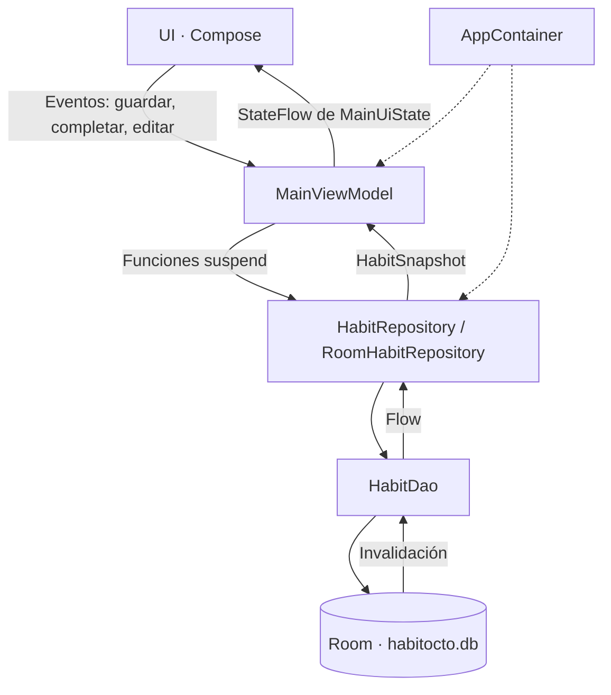

# HabitOcto · Fase 2: arquitectura y datos

Aplicación Android de seguimiento de hábitos y microhábitos, desarrollada con Kotlin y Jetpack Compose. Room es la fuente local de verdad: hábitos, avances, historial, perfil, tema y publicaciones se recuperan al volver a abrir la aplicación.

## Integrantes

- Pablo Orantes
- Kevin Moreno
- Fabiola Garzaro
- Diego Castillo
- Marco Soloj

## Alcance de esta fase

El objetivo comunicado por el equipo es agregar una base de datos para guardar los datos de la app. El ZIP recibido ya incluía una implementación amplia de Room; esta entrega conserva esa base y completa la separación de responsabilidades, los estados de pantalla, pruebas y documentación.

| Requisito | Implementación y evidencia |
| --- | --- |
| Entidades del dominio | `UserEntity`, `HabitEntity`, `HabitRecordEntity`, `FeedPostEntity`, `DataImportEntity`. |
| DAO reactivo | `HabitDao.observeUser()` devuelve `Flow<UserWithData?>` con `@Transaction`; las escrituras son `suspend`. |
| Base única | `HabitDatabase.get(applicationContext)`, con `@Volatile` y `synchronized`. |
| ViewModel desacoplado | `MainViewModel` recibe `HabitRepository`. `di/AppContainer` construye las dependencias. |
| Estado inmutable y UDF | `StateFlow<MainUiState>` de solo lectura; `_uiState` es privado. La UI llama funciones del ViewModel. |
| Ciclo de vida | `collectAsStateWithLifecycle()` en el contenedor Compose. |
| Carga, vacío, éxito y error | `MainUiState.dataState` usa `UiState`; `DataStateContent` muestra carga/error con reintento. Tracker y Feed muestran sus vacíos. |
| Formulario sin reglas de dominio | `AddHabitScreen` emite `HabitDraft`. El ViewModel valida mediante `toHabitItem()` y guarda por el repositorio. |
| Persistencia y migración | `habitocto.db`, versión 2; migración 1→2 sin borrado destructivo; pruebas de reapertura y migración. |

Las clases están en `app/src/main/java/com/example/`, organizadas en `ui`, `viewmodel`, `model` y `di`.

## Arquitectura y flujo de datos



Recorrido de un dato: Guardar Hábito emite un borrador → `saveHabitDraft()` valida → `repository.save()` persiste la definición y su período dentro de una transacción → Room vuelve a emitir → `render()` reconstruye el estado → Compose se actualiza. El formulario se cierra solo después de guardar. Un error conserva los campos. La pantalla no consulta el DAO ni crea la base de datos.

`dataState` describe la carga; `isSaving` describe una escritura en curso y `error` un fallo de una acción. Un fallo inicial pasa a Error y deja de mostrar el indicador de carga. Reintentar puede reiniciar una observación fallida. Vacío significa que no hay hábitos activos; Feed y Perfil siguen disponibles.

## Datos persistentes

| Datos | Tabla / comportamiento |
| --- | --- |
| Perfil y tema | `users`: nombre, correo, avatar y modo oscuro; perfil local sin login remoto. |
| Hábitos | `habits`: título, categoría, frecuencia, meta, etiquetas, duración y preferencias de recordatorio. |
| Avances e historial | `habit_records`: registro por hábito y período; conserva definiciones históricas. |
| Publicaciones y reacciones | `feed_posts`: texto, categoría, referencia a imagen, fecha, autor y reacción local. |
| Importación única | `data_imports`: evita duplicados y restaurar hábitos archivados. |

Eliminar archiva el hábito y conserva su historial. El hábito diario abre otro período al cambiar de fecha; el semanal mantiene su avance hasta el cierre de semana. Las consultas y escrituras de Room no se ejecutan en el hilo de UI. No se usa `allowMainThreadQueries()` ni migración destructiva.

Las imágenes locales se referencian por URI con permiso persistente; las remotas necesitan conexión para descargarse. Las estadísticas se calculan desde registros. Las contraseñas, notificaciones automáticas, sincronización social y autenticación Firebase no están implementadas en esta fase. Las preferencias de recordatorio sí se guardan.

Detalles de datos y reglas: [PERSISTENCIA.md](PERSISTENCIA.md).

## Ejecutar y verificar

Abrir esta carpeta en Android Studio compatible con AGP 9.4.1 y sincronizar Gradle. Se conservan las versiones recibidas: Gradle 9.8.0, daemon JDK 21 y SDK de compilación 36.1. La ruta local del SDK y los archivos privados se configuran en cada equipo y no se distribuyen.

```powershell
.\gradlew.bat :app:assembleDebug :app:testDebugUnitTest :app:lintDebug
```

Las pruebas cubren fechas/rachas, importación única, validación, carga fallida y reintento, cambios reactivos, reapertura de Room, migración 1→2 y componentes Compose. Los reportes se generan en `app/build/reports/` y las capturas en `app/build/reports/habitocto/`.

Ver [docs/VALIDACION.md](docs/VALIDACION.md) para los resultados y límites reales. La prueba manual de cerrar y reabrir en el dispositivo de la presentación se describe en [docs/DEMO_FASE2.md](docs/DEMO_FASE2.md).

## Planificación y feedback

[docs/AVANCE_FASE2.md](docs/AVANCE_FASE2.md) registra el objetivo informado, avance y tareas pendientes del equipo. No se recibió un calendario original con fechas para comparar retrasos o adelantos.

El equipo no recuerda los comentarios de UI. [docs/FEEDBACK.md](docs/FEEDBACK.md) registra esa limitación y permite documentar los comentarios reales al recuperarlos. Las mejoras técnicas de esta entrega no se presentan como feedback del catedrático.

## Uso de IA y revisión del equipo

Esta actualización se preparó con ayuda de Codex a partir del ZIP y los requisitos de Fase 2. La base Room, repositorio, importación y pantallas ya existían; esta sesión no permite atribuir su autoría previa.

Con ayuda de IA se revisó UDF, se separó la creación de dependencias del ViewModel, se conectaron los cuatro estados, se extrajo la validación del hábito del Composable, se añadieron pruebas y se redactó la documentación. Se conservó la configuración de AGP, Gradle y SDK.

El equipo aún debe revisar los cambios, ejecutar la demo y poder explicar DAO, estado, flujo de datos y persistencia. No se afirma una revisión ni ajustes manuales del equipo que todavía no se han confirmado.

## Entrega

Crear una rama de Fase 2 y un Pull Request hacia `main`, revisar todos sus cambios y entregar su enlace en Canvas antes de clase. El ZIP de origen no incluye metadatos de Git; esta entrega local no crea ni publica un PR. [docs/PR_FASE2.md](docs/PR_FASE2.md) contiene una descripción para adaptar.
